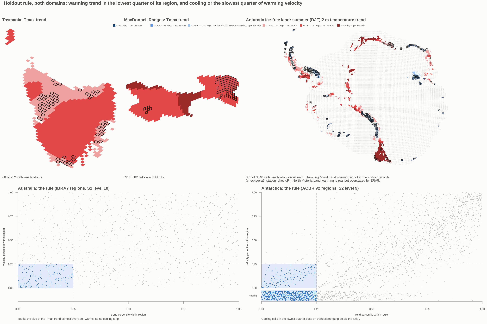

One pipeline now scores climate holdouts in both terrestrial Australia (Tasmania and the MacDonnell Ranges) and the Australian Antarctic Territory region (sea ice, Southern Ocean surface temperature and ice-free land). It works the same way in both: per-cell sums on S2 cells, trends and velocities computed from those sums, and one holdout rule scored within regions.

- **Australia:** Tmax has warmed by a median 0.12 to 0.25 deg C per decade since 1971, and 45% of cells have a trend at least twice its noise. About 9% of cells pass the thermal holdout rule, and water and green-cover persistence add separate flags.
- **Antarctica:** summer warming of ice-free land is small and mostly within year-to-year noise; only 15% of cells reach twice the noise. A quarter of cells pass the same rule, many of them because they are cooling.
- **Station check:** the ERA5 warming in Dronning Maud Land is not in the station records, and North Victoria Land warming is real but overstated. Both caveats are below.

The pilots are exploratory and not a product: the rule's thresholds (lowest quarter) are a choice, and nothing has been field-validated. The results are written up in [Where the climate holdouts are](index.html).

## The shared approach

Every source is reduced to per-cell sufficient statistics on S2 cells, so any union of cells adds exactly and every number can be checked against a direct summary.

1. **Cells.** Australia uses S2 level 13 (about 1 km2) for satellite persistence and level 10 (about 80 km2) for gridded climate. Antarctica uses level 9 (about 300 km2) for ERA5, sea ice and SST, and level 13 for ice-free rock and the Ecosystem Inventory.
2. **Sums.** Each pixel goes to the cell holding its centre (finer grids are split for area weights). Per cell and year the pipeline stores counts, sums and sums of squares, and a gate checks the cell totals against the grid totals.
3. **Exposure.** Trend per decade, signal-to-noise (trend over residual noise) and climate velocity (trend over the local spatial gradient, km per decade) are all computed from the sums.
4. **Holdout rule.** Cells are scored within their regions (IBRA7 subregions in Australia, ACBR v2 on Antarctic land, sea ice sectors at sea). A cell is a holdout when its warming trend is in its region's lowest quarter, and it is either cooling or in the slowest quarter of warming velocity. Sea ice uses the same rule with least ice loss in place of least warming.
5. **Shared outputs.** Long tables `cells_metrics.parquet` and `cells_flags.parquet` with one vocabulary across domains, `rules.csv`, `bridge_summary.csv`, and Cloud Optimized GeoTIFFs for each pilot.

## Australia: Tasmania and the MacDonnell Ranges

The Australian pilot flags three kinds of holdout in nine IBRA regions: thermal (AGCD climate, 1971-2025), water (DEA Water Observations, 1987-2025) and green cover (DEA Fractional Cover, 1988-2025). No cell is flagged by all three.

| IBRA | L13 cells | thermal | water | green | water + thermal | green + thermal |
| --- | --- | --- | --- | --- | --- | --- |
| MAC (MacDonnell Ranges) | 37,693 | 4,480 | 252 | 8,759 | 22 | 446 |
| TWE (Tasmanian West) | 14,590 | 1,312 | 1,848 | (not used) | 250 | |
| TSE (Tasmanian South East) | 10,386 | 737 | 1,684 | (not used) | 80 | |
| TCH (Tasmanian Central Highlands) | 7,281 | 912 | 1,846 | (not used) | 64 | |
| TSR (Tasmanian Southern Ranges) | 7,194 | 582 | 1,511 | (not used) | 96 | |
| BEL (Ben Lomond) | 6,391 | 367 | 544 | (not used) | 46 | |
| TNS (Tasmanian Northern Slopes) | 6,032 | 260 | 1,439 | (not used) | 103 | |
| KIN (King) | 4,198 | 0 | 695 | (not used) | 0 | |
| TNM (Tasmanian Northern Midlands) | 3,981 | 81 | 1,183 | (not used) | 23 | |

- **Thermal:** median Tmax trends run from +0.12 (TNS) to +0.25 deg C per decade (MAC), and rainfall has fallen in most regions. 140 of 1,521 level 10 cells are thermal holdouts.
- **Water:** pixels on mapped artificial water (Overture reservoirs, ponds, near-rectangular dams) are removed first. In Tasmania persistent natural water is still found in about 15% of cells, so it discriminates poorly there; in the MacDonnell Ranges it picks out springs and gorge pools.
- **Green cover:** used only in the MacDonnell Ranges. In Tasmania growth is limited by light and temperature, so dry years are greener and the dry-year test means something else.

## Antarctica: sea ice, ocean and ice-free land

The Antarctic pilot covers everything south of 60S with three exposure layers and the same rule, then sets the land holdouts against the region's conservation layers.

| layer | source, period | cells (S2 level 9) | holdouts | cells with abs(snr) >= 2 |
| --- | --- | --- | --- | --- |
| Sea ice (ice days per year) | NSIDC CDR via trend.ice, 1979-2025 | 47,839 | 7,584 (16%) | 5% |
| Summer sea surface temperature | OISST v2.1, 1982-2025 | 44,862 | 11,004 (25%) | 2% |
| Summer 2 m air temperature, ice-free land | ERA5, DJF 1980-2026 | 3,346 | 803 (24%) | 15% |

- **Sea ice:** the Weddell, Indian and Bellingshausen-Amundsen sectors lose ice days in 70-83% of cells, while the Ross and W Pacific sectors are mixed. Cell sums reproduce the NSIDC Sea Ice Index extent (anomaly correlation 0.99).
- **Ice-free land:** the 803 level 9 holdouts hold 39,016 level 13 rock cells and are scored within the 16 ACBR v2 regions. Rock area per ACBR matches the official ACBR v2 areas within 5% in 15 regions (South Orkney Islands 0.66).
- **Protected areas:** candidate land holdouts touch an ASPA at half the rate of ice-free land overall (0.5% against 1.1% of cells). ASPAs sit on coastal sites, while the holdouts lean inland and to the slow-warming ranges.
- **Ecosystem Inventory (Toth et al. 2024):** the inventory maps 89,050 km2 of ice-free land against 72,201 km2 in rock outcrop v7.3. Holdouts carry much less of habitat 31 than ice-free land overall (0.6% against 3.7%). At 100 m, 4,275 level 13 holdout cells are at least 1 deg C cooler than their level 9 parent: micro-scale buffers inside macro-scale holdouts.
- **Class names:** habitat names are still missing; the value tables hold only class numbers.

## The bridge: one rule, two domains

The same thermal holdout rule picks out about a tenth of Australian cells and a quarter of Antarctic land cells. The difference reflects the signal, not the method: Australian Tmax is warming clearly almost everywhere, while Antarctic summer trends sit close to zero, so many Antarctic cells pass because they are cooling.

| domain | cells | holdouts | share | median trend per decade | cells with abs(snr) >= 2 |
| --- | --- | --- | --- | --- | --- |
| Australia, Tmax (S2 level 10) | 1,521 | 140 | 9% | +0.18 deg C | 45% |
| Antarctic ice-free land, summer 2 m T (level 9) | 3,346 | 803 | 24% | +0.06 deg C | 15% |
| Antarctic ocean, summer SST (level 9) | 44,862 | 11,004 | 25% | +0.015 deg C | 2% |
| Antarctic sea ice, ice days (level 9) | 47,839 | 7,584 | 16% | -1.4 days | 5% |

The figure below shows the trends on one colour scale with the holdouts outlined (top), and the rule as each cell's trend percentile against its velocity percentile within its region (bottom). Two details differ by domain:

- Australia ranks the size of the trend, and it has no cooling cells.
- In Antarctica, cooling cells in the lowest quarter pass on trend alone. They form the strip below the axis.

Script: `pilots/bridge_map.R`.

## Checks and caveats

The sums pass every gate set so far. The main limits are the Antarctic temperature source and the coarse scale of the climate layers.

**Checks that passed**

- **Cell sums against direct summaries.** ERA5 (to 2e-13 deg C), sea ice, SST and Australian WOfS tiles all match.
- **WOfS subregion gate.** For King (KIN01, 39 years, 1.7 billion clear observations), the pipeline's cell sums equal a direct read of the DEA rasters exactly.
- **Sea ice.** Cell sums reproduce the NSIDC Sea Ice Index extent (anomaly correlation 0.99, mean ratio 1.03).
- **ACBR areas.** Rock area per ACBR matches the official ACBR v2 areas within 5% in 15 of 16 regions.

**Caveats**

- **ERA5 in Dronning Maud Land.** Its summer warming (+0.32 deg C per decade) is not in the stations. Neumayer (43 summers) and Novolazarevskaya (39) are flat, and ERA5 minus station steps up by 1.4 to 1.9 deg C after 2000. Holdouts there are ranked within the region, but the trend values should not be quoted.
- **ERA5 in North Victoria Land.** Its warming (+0.52) is likely real but overstated: three of four stations warm, by about 0.5 deg C per decade less than ERA5 over the same summers. Records only start after 2000.
- **Elsewhere in Antarctica,** from Syowa round to Dumont d'Urville and on the Peninsula, ERA5 follows the stations well (r 0.7 to 0.94, trends within 0.15 deg C per decade).
- **Scale.** ERA5 at 0.25 deg and AGCD at 5 km describe the regional climate around a site, not the rock or valley floor. These are macro-scale holdouts; the 100 m inventory temperatures show a median spread of 0.35 deg C inside a level 9 cell.
- **Coastal water counts.** Coastal WOfS cells include sea, so cell wet fractions there are inflated (2.65 times the wet count of the King polygon). The water flags use land pixels only and are not affected.
- **Artificial water.** It is removed by mapped features plus a short hand-checked list. One MacDonnell cluster (131.98E, 23.78S, 3 cells) is unverified and flagged for review.
- **The rule is a choice.** Lowest quarter within region means every region has holdouts by construction; a region-free threshold would give a different map.
- **Not validated.** No holdout has been compared with biological records.

## Next steps

1. **A second Antarctic temperature source.** Use station-adjusted or reanalysis-independent records to replace or correct ERA5 in Dronning Maud Land: READER, the AWS archive, or a second reanalysis such as MERRA-2 or JRA-3Q.
2. **Micro-scale buffers.** Use the 100 m Ecosystem Inventory temperature and degree days, and REMA terrain, to rank cells inside the macro-scale holdouts.
3. **Habitat names.** Add the Ecosystem Inventory class names when the lookup table is found, so the habitat make-up of holdouts can be read.
4. **More Australian regions.** Extend beyond the two pilot areas, and add a hand-checked water exclusion step for each new region.
5. **Embeddings, after the MVP.** AlphaEarth annual embeddings (on source.coop, covering Antarctic land) could test whether holdouts differ in surface character from the cells around them. They describe the surface, not the climate, so they add a check rather than a new exposure layer.
