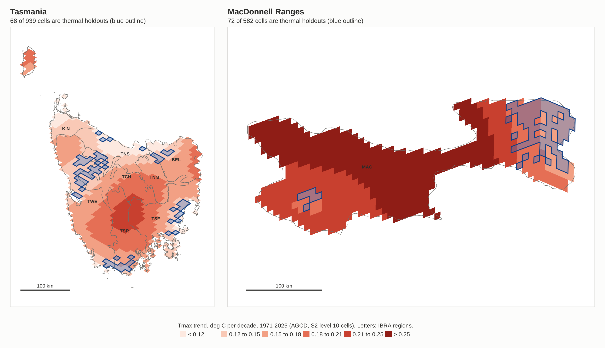
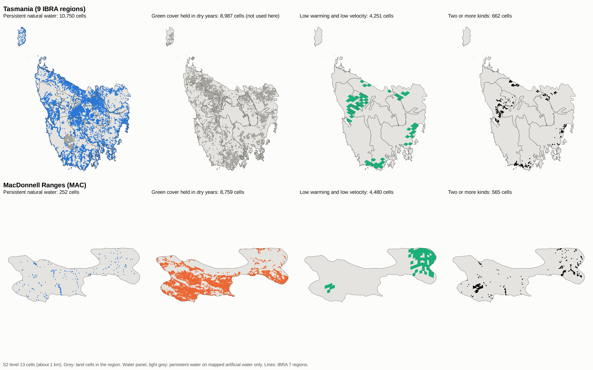
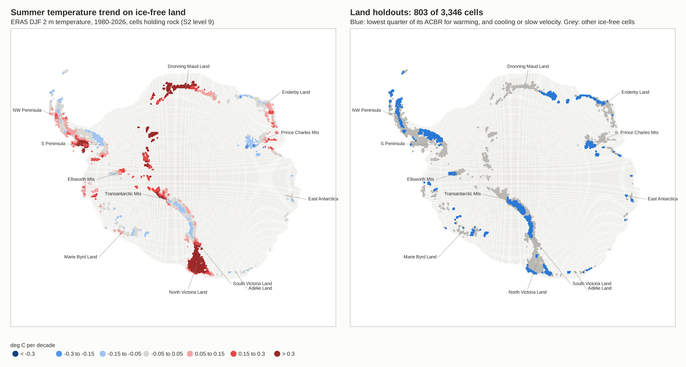
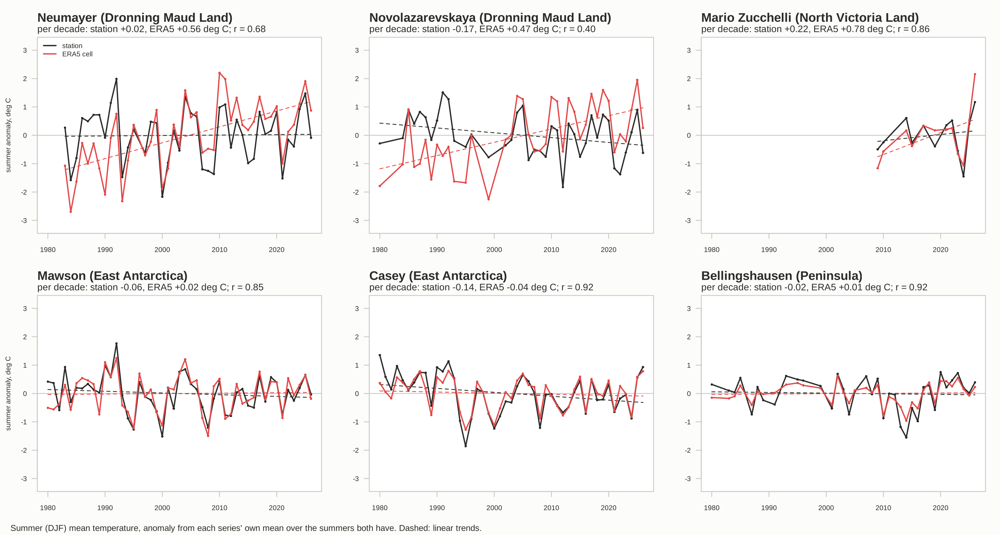
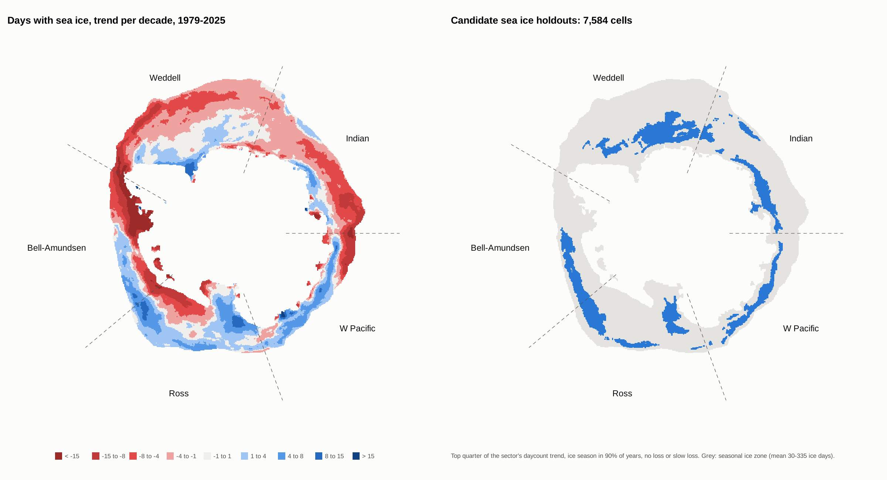
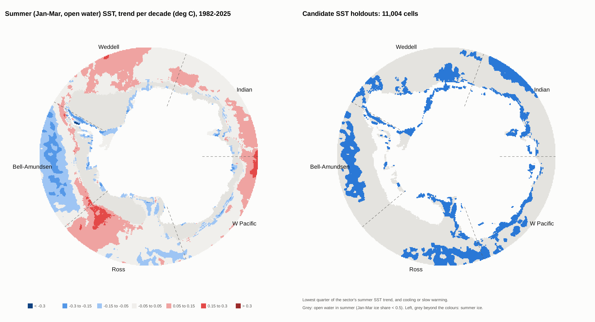
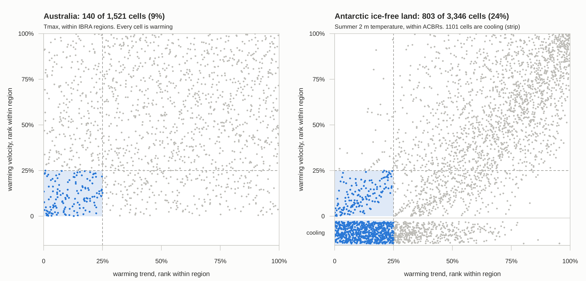

Climate holdouts are places changing least within their own region. In Australia they are a small, clearly bounded minority in a landscape that is warming everywhere. In Antarctica they are a larger share of a landscape whose summers have barely changed.

- **Australia is warming everywhere.** Every cell in Tasmania and the MacDonnell Ranges has a rising Tmax (median +0.18 deg C per decade since 1971). The thermal holdouts are 140 of 1,521 cells (9%): western and north-west Tasmania, the south-east coast, and the eastern MacDonnell Ranges.
- **Antarctic ice-free land has mostly not warmed in summer.** Outside two regions the median trend is within 0.1 deg C per decade of zero, and a third of cells have cooled slightly since 1980. Holdouts are 803 of 3,346 cells (24%).
- **The two apparent Antarctic hot spots need care.** Stations do not show the ERA5 warming in Dronning Maud Land. North Victoria Land is warming, but by less than ERA5 says.
- **At sea, the ice is where the change is.** Sea ice days are falling in 70 to 83% of cells in three of five sectors, while summer sea surface temperature shows almost no trend above noise.
- **Holdouts and protection select different ground.** Antarctic land holdouts touch a protected area (ASPA) at half the rate of ice-free land in general.

The companion [MVP brief](brief.html) covers the method and checks, and the [framework](framework.html) sets out the approach.

## Australia: holdouts in a warming landscape

Thermal holdouts sit at the edges of each region's warming, not at its centre. Tasmania's interior and the central MacDonnell Ranges are warming fastest, and no holdout falls there.

- **Tasmania.** Tmax trends run from under +0.12 deg C per decade on the north and north-west coast to over +0.21 in the Central Highlands and Southern Ranges. The 68 holdout cells cluster in the western ranges (22 in Tasmanian West, 14 on the western edge of the Central Highlands), along the south-east coast (12) and on the far south coast (9).
- **MacDonnell Ranges.** Warming is stronger (median +0.25) and has a clear west to east gradient. 72 holdout cells form one block at the eastern end, with a small patch in the south-west.
- **King Island has no thermal holdout.** None of its 63 cells is in the lowest quarter for both trend and velocity.

Water and green cover give a second and third view of the same landscapes at about 1 km.

| Region | cells (1 km) | thermal | persistent natural water | green held in dry years | two or more kinds |
| --- | --- | --- | --- | --- | --- |
| Tasmania (9 IBRA regions) | 60,053 | 4,251 | 10,750 | (not used) | 662 |
| MacDonnell Ranges | 37,693 | 4,480 | 252 | 8,759 | 565 |

- **MacDonnell water is rare and specific.** 252 cells (0.7%) hold water that persisted through 1987 to 2025, after removing sewage ponds, dams and the effluent-fed Ilparpa claypans. 22 of them are also thermal holdouts.
- **Green cover holds up through drought across much of the south.** 8,759 MacDonnell cells keep their green cover in the region's five driest years, and 446 of these are thermal holdouts too.
- **Tasmanian water does not discriminate.** Persistent natural water is in 18% of cells, so it is a weak filter on its own there; water together with a thermal holdout picks out 662 cells.

## Antarctic ice-free land: mostly stable summers, two hot spots

Summer air temperature over ice-free land has changed little since 1980 in 14 of the 16 biogeographic regions (ACBRs). In those regions the median trend is between -0.03 and +0.11 deg C per decade, and almost no cell has a trend that stands clear of year-to-year noise.

| ACBR | rock, km2 | summer mean, deg C | trend, deg C per decade | holdout cells (level 9) |
| --- | --- | --- | --- | --- |
| Transantarctic Mountains | 19,223 | -18.3 | +0.06 | 173 of 690 |
| South Victoria Land | 10,293 | -13.6 | +0.03 | 49 of 195 |
| North Victoria Land | 9,451 | -13.5 | +0.52 | 65 of 383 |
| Prince Charles Mountains | 5,983 | -12.3 | -0.01 | 57 of 229 |
| Dronning Maud Land | 5,514 | -16.4 | +0.32 | 73 of 297 |
| Central south Antarctic Peninsula | 4,867 | -5.3 | +0.08 | 86 of 345 |
| North-west Antarctic Peninsula | 4,796 | -0.8 | +0.04 | 85 of 339 |
| Ellsworth Mountains | 2,940 | -16.7 | +0.05 | 22 of 87 |
| South Antarctic Peninsula | 2,932 | -11.7 | -0.02 | 54 of 217 |
| Enderby Land | 2,126 | -7.4 | +0.01 | 51 of 203 |
| North-east Antarctic Peninsula | 1,316 | -1.2 | -0.03 | 10 of 38 |
| Marie Byrd Land | 1,148 | -9.6 | -0.03 | 38 of 152 |
| East Antarctica | 1,076 | -4.4 | -0.02 | 15 of 59 |
| Ellsworth Land | 218 | -5.6 | +0.11 | 13 of 64 |
| Adelie Land | 171 | -5.6 | -0.02 | 9 of 37 |
| South Orkney Islands | 105 | +0.3 | -0.03 | 3 of 11 |

Trends are ERA5 summer (December to February) 2 m temperature, 1980 to 2026, medians over the cells that hold rock.

- **Where the holdouts are.** The largest groups are along the Transantarctic Mountains, the Antarctic Peninsula, part of the Prince Charles Mountains and the Enderby Land coast. Together the 803 cells hold 39,016 one-kilometre rock cells.
- **The Peninsula shows almost no summer trend over this period.** That is consistent with the known pattern of warming before 2000 and a pause after it.
- **North Victoria Land is the one region with clear warming.** 84% of its cells have a trend at least twice the noise. Its 65 holdouts are the least-warming cells of a warming region, not stable ground.

### What the stations say about the two hot spots

ERA5 follows the station records closely around East Antarctica and on the Peninsula, but not in Dronning Maud Land.

- **Dronning Maud Land.** Neumayer (43 summers) and Novolazarevskaya (39) show +0.02 and -0.17 deg C per decade. ERA5 shows +0.56 and +0.47 at the same places and summers, because it runs 1.4 to 1.9 deg C warmer relative to the stations after 2000 than before. The regional warming is an artefact of the reanalysis.
- **North Victoria Land.** Records start after 2000. Three of four stations warm, by about 0.5 deg C per decade less than ERA5.
- **Elsewhere.** At Mawson, Davis, Casey, Mirny, Syowa and the Peninsula stations, station and ERA5 trends agree within 0.15 deg C per decade, with correlations of 0.7 to 0.94.

## Southern Ocean: sea ice is changing, surface temperature is not

Sea ice is losing days in most of the Weddell, Indian and Bellingshausen-Amundsen sectors, and gaining slightly in the Ross and W Pacific sectors. Sea ice holdouts are 7,584 of 47,839 cells (16%) in the seasonal ice zone.

| Sector | median trend, ice days per decade | cells losing ice days | sea ice holdouts | summer SST trend, deg C per decade | SST holdouts |
| --- | --- | --- | --- | --- | --- |
| Weddell | -1.9 | 70% | 2,351 | +0.04 | 2,308 |
| Indian | -2.7 | 83% | 1,415 | +0.03 | 1,793 |
| W Pacific | +1.7 | 41% | 959 | +0.02 | 1,342 |
| Ross | +1.4 | 34% | 1,804 | +0.01 | 2,909 |
| Bellingshausen-Amundsen | -5.6 | 70% | 1,055 | -0.08 | 2,652 |

Sea ice: days with ice per year, 1979 to 2025. SST: January to March in the summer open-water zone, 1982 to 2025.

- **Loss is strongest in the Bellingshausen-Amundsen sector,** at a median 5.6 fewer ice days per decade and far more near the coast.
- **Sea ice holdouts form bands, not scattered cells.** They follow the coast in the Indian and W Pacific sectors and sit in the southern Weddell and outer Ross and Amundsen pack.
- **Summer surface temperature has no usable trend yet.** Only 2% of cells have a trend twice the noise, so the 11,004 SST holdouts rank small differences and should be read as provisional.

## Antarctic holdouts against protection and habitat

Antarctic land holdouts and Antarctic Specially Protected Areas (ASPAs) select different ground: 0.5% of holdout cells touch an ASPA, against 1.1% of all ice-free cells.

- **ASPAs are coastal; holdouts lean inland.** 72 of the 75 ASPAs touch ice-free land, mostly at bird colonies and moss beds on the coast. The holdouts lean to the inland ranges. The gap is widest on the Peninsula (0.2% against 1.2%).
- **The Indian sector is the exception.** There 1.4% of holdout cells touch an ASPA, around the Larsemann and Vestfold Hills and the Prince Charles Mountains coast.
- **At sea,** none of the sea ice holdouts and 2 of the SST holdouts touch one of the 7 marine ASPAs.
- **Holdouts carry the same habitats as ice-free land in general, with one exception.** In the Antarctic Ecosystem Inventory (Toth et al. 2024), habitat class 31 makes up 3.7% of ice-free area but 0.6% of holdout area. Its name is not yet matched to the class number.
- **Cool pockets inside holdouts.** At 100 m, 14,244 one-kilometre cells are at least 1 deg C cooler than their surroundings, and 4,275 of them sit inside land holdouts. These are the candidates for micro-scale buffers within a macro-scale holdout.

## Same rule, different signal

The holdout rule is the same in both domains, and it selects 9% of Australian cells but 24% of Antarctic land cells. The gap comes from cooling: no Australian cell is cooling, while 1,101 Antarctic land cells are, and a cooling cell in its region's lowest quarter passes without the velocity test.

| Domain | cells with a trend at least twice the noise | holdouts |
| --- | --- | --- |
| Australia, Tmax | 45% | 9% |
| Antarctic ice-free land, summer temperature | 15% | 24% |
| Antarctic sea ice, ice days | 5% | 16% |
| Southern Ocean, summer SST | 2% | 25% |

A holdout therefore means different things. In Australia it is a place warming less than its neighbours. In Antarctica it is usually a place that has not warmed at all: 652 of the 803 land holdouts have a cooling trend.

## How far to trust each result

The Australian thermal result and the Antarctic sea ice result rest on clear signals. The Antarctic land and ocean temperature results rank small differences and depend on one reanalysis or one satellite product.

| Result | Confidence | Why |
| --- | --- | --- |
| Australian thermal holdouts | Good | Station-based grid over 55 years; 45% of cells have a clear trend. The grid is 5 km, so it describes districts, not gullies. |
| MacDonnell water and green cover | Good for pattern | 30 m satellite record over 39 years. One water cluster (131.98E, 23.78S) is unverified. |
| Tasmanian water | Weak | Persistent water is too common to discriminate. |
| Sea ice holdouts | Good | Cell sums reproduce the NSIDC Sea Ice Index (anomaly correlation 0.99). |
| Antarctic land holdouts outside the two hot spots | Moderate | ERA5 matches stations there, but trends are small against noise. |
| Dronning Maud Land | Do not quote the trend | The ERA5 warming is not in the stations. |
| North Victoria Land | Direction only | Warming is real but ERA5 overstates it. |
| SST holdouts | Provisional | 2% of cells have a clear trend. |

Two limits apply throughout. Lowest quarter within a region is a choice, so every region has holdouts by construction. And no holdout has yet been compared with biological records.
